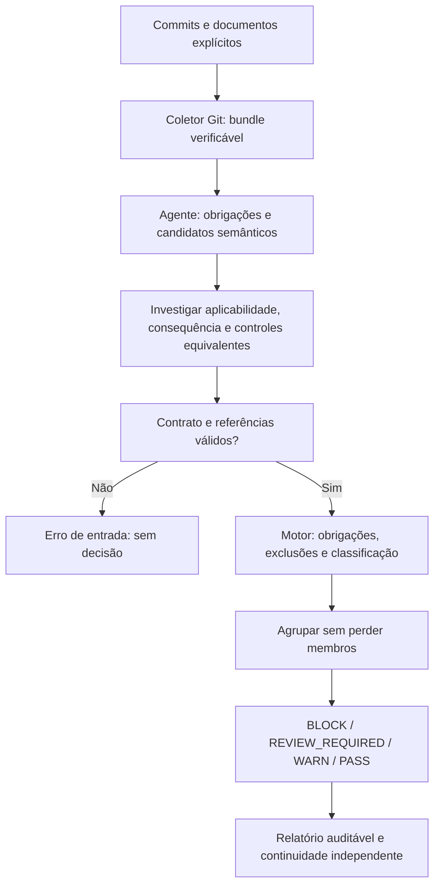

# Intent Verification Skill

Implementação inicial de uma skill **independente**, focada somente no alinhamento de uma mudança com a intenção documentada. O planejamento das três etapas permanece no repositório `backend-quality-gate`; este projeto inicia a divisão em skills separadas conforme a nova decisão de escopo.

## O que funciona nesta versão

- Coleta de diff e documentos versionados entre commits explícitos, sem alterar aplicação.
- Skill com fluxo de análise semântica assistida pelo agente, incluindo investigação antes da triagem.
- Validação estrita de contrato, referências, hashes e vínculo com a mudança.
- Triagem determinística: PASS, WARN, REVIEW_REQUIRED e BLOCK.
- Obrigações avaliadas independentemente de candidatos; ausência de evidência não vira aprovação.
- Exclusões justificadas, agrupamento por causa/correção e preservação dos membros.
- Separação entre bloqueio de aprovação e dependência de execução.
- Exemplos sintéticos e testes do motor, CLI e coletor em um repositório Git temporário.

Não inclui uma chamada autônoma a LLM, análise de segurança, cobertura de testes ou serviço web. O agente que usa [SKILL.md](SKILL.md) produz a interpretação estruturada; o motor não prova significado ou relevância apenas por verificar referências.

## Executar

Requisito: Python 3.10+ e Git. Não há dependências a instalar. Execute da raiz deste repositório:

```bash
python3 -m unittest discover -s tests -v
python3 -m intent_gate triage --bundle examples/bundle.json --analysis examples/analysis.json --policy policies/intent-v1.json
```

O exemplo deve retornar `BLOCK`, mas `can_continue: true`: uma violação mandatória não depende de resposta humana para concluir a análise.

Para analisar uma mudança real:

```bash
python3 -m intent_gate collect --repo /caminho/do/projeto --base COMMIT_BASE --head COMMIT_HEAD --document docs/spec.md
```

Salve a saída em um arquivo novo. O agente analisa o conteúdo e prepara uma análise conforme o exemplo e o [contrato](docs/contract.md). Então execute `triage` com esses arquivos. O coletor considera somente os commits selecionados; não incorpora modificações locais. Não use o exemplo sintético como análise de uma mudança real.

CLI exit 0 significa avaliação concluída, não aprovação. O consumidor precisa ler `decision`; entrada inválida sai com código 2 e sem decisão.

## Fluxo



## Limites e avaliação

Os testes verificam implementação e regras, não a qualidade de interpretação do modelo. Hashes detectam inconsistência interna, não garantem autenticidade do bundle. Estados como `supported` e `scope_complete` exigem julgamento fundamentado do agente. Leia o [contrato e a rubrica](docs/contract.md).

Antes de adoção corporativa, avaliar mudanças representativas com resultados de referência: contradições reais, diferenças apenas textuais, controles compensatórios, omissões, documentos conflitantes e hipóteses críticas inconclusivas. Medir falsos positivos, violações omitidas, perguntas e variação entre execuções semânticas. Não alegar redução de ruído ou detecção de defeitos reais apenas por testes unitários passando.

Uma revisão normal não altera código nem cria testes na aplicação avaliada. Waivers e aceites formais ficam fora da v1; não permitir descarte informal de P0/P1.
